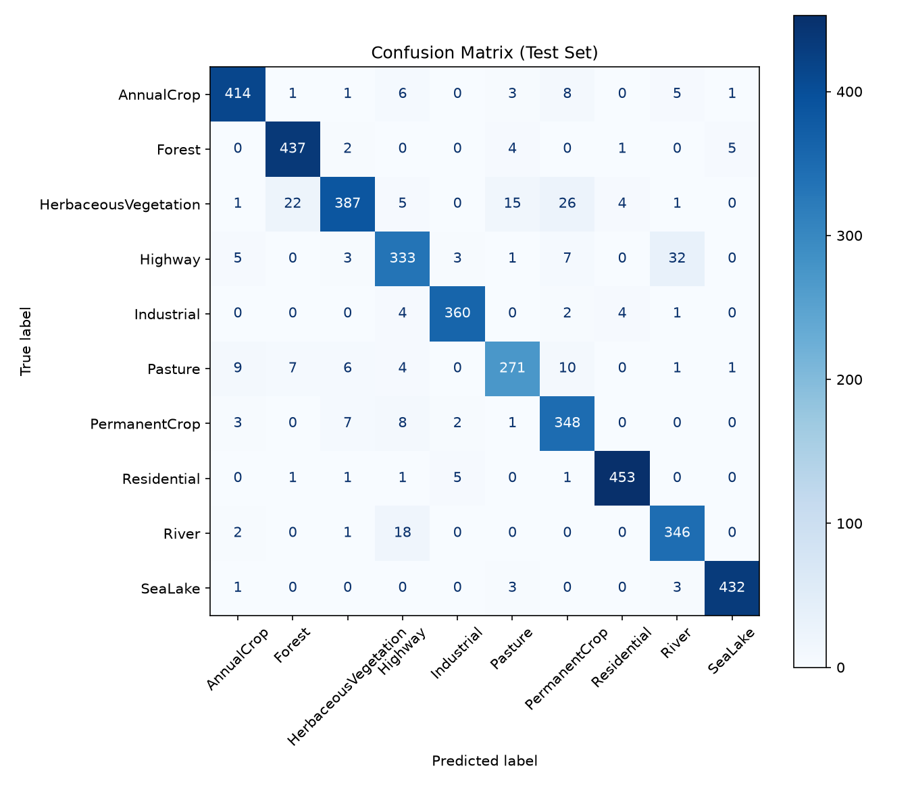
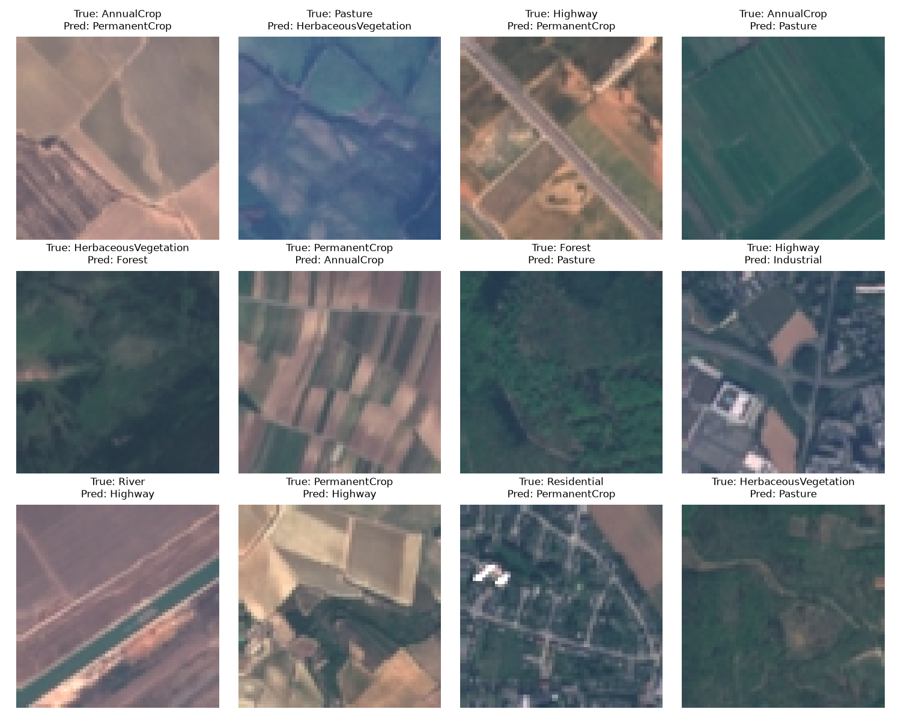

# EuroSAT Land Cover Classification

Classifying satellite images into 10 land-cover classes using transfer learning with a pretrained **ResNet18** in **PyTorch**.

The final model reaches **93.4% test accuracy** on 4,050 held-out images.

## Dataset

[EuroSAT](https://github.com/phelber/eurosat) is based on Sentinel-2 satellite images.

- 27,000 labeled RGB images, 64x64 pixels
- 10 classes: `AnnualCrop`, `Forest`, `HerbaceousVegetation`, `Highway`, `Industrial`, `Pasture`, `PermanentCrop`, `Residential`, `River`, `SeaLake`
- Downloaded automatically in the notebook with `torchvision.datasets.EuroSAT` (the data is not stored in this repo)

## Approach

1. **Data split:** stratified 70% train / 15% validation / 15% test (18,900 / 4,050 / 4,050 images), so every class has the same share in each set
2. **Augmentation (train only):** random horizontal flip, random rotation (15 degrees), color jitter (brightness and contrast); ImageNet normalization
3. **Transfer learning with ResNet18 (ImageNet weights), in two stages:**
   - **Stage 1:** freeze the whole network and train only the new final layer (5 epochs, Adam, lr 1e-3)
   - **Stage 2:** unfreeze the last residual block (`layer4`) and fine-tune it with the final layer (10 epochs, Adam, lr 1e-4)
4. **Evaluation:** accuracy, classification report, confusion matrix, and a look at misclassified images

## Results

| Metric | Value |
|---|---|
| Validation accuracy (best of stage 2) | about 93% |
| **Test accuracy** | **93.4%** |
| Macro F1 (test) | 0.931 |
| Misclassified | 269 of 4,050 test images |

Most common confusions on the test set:

| True class | Predicted as | Images |
|---|---|---|
| Highway | River | 32 |
| HerbaceousVegetation | PermanentCrop | 26 |
| HerbaceousVegetation | Forest | 22 |
| River | Highway | 18 |
| HerbaceousVegetation | Pasture | 15 |

The errors mostly happen between visually similar classes (for example different crop types, or roads and built-up areas).




## How to run

```bash
# 1. Clone the repo
git clone https://github.com/pratham636/EuroSAT-Land-Cover-Classification.git
cd EuroSAT-Land-Cover-Classification

# 2. Create and activate a virtual environment
python -m venv .venv
.venv\Scripts\activate          # Windows
# source .venv/bin/activate     # Mac / Linux

# 3. Install dependencies
pip install -r requirements.txt

# 4. Open the notebook and run all cells
jupyter notebook EuroSAT_land_cover_classification.ipynb
```

The dataset (about 90 MB) downloads automatically on the first run.

**GPU:** training is much faster on a CUDA GPU. For GPU support, install PyTorch first using the command from [pytorch.org](https://pytorch.org/get-started/locally/), then run `pip install -r requirements.txt`.

## Project structure

```
├── EuroSAT_land_cover_classification.ipynb   # data, training, evaluation
├── requirements.txt
├── README.md
├── .gitignore
└── images/                                   # result plots used in this README
```

## Tech stack

Python, PyTorch, torchvision, scikit-learn, pandas, NumPy, Matplotlib, Pillow

## Author

**Pratham Shah**, AI Engineering student at the University of Passau
GitHub: [@pratham636](https://github.com/pratham636)